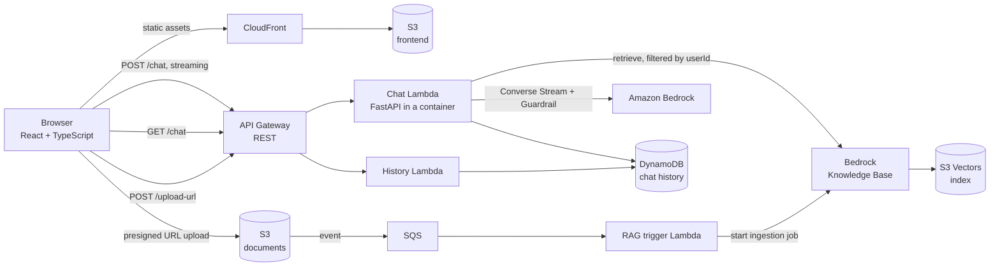

# Serverless GenAI Chatbot with RAG on AWS

A serverless chatbot on AWS that answers with streamed responses from Amazon Bedrock, remembers the conversation, and uses the documents each user uploads as context (RAG). The whole infrastructure is written in Terraform, with separate development, test and production environments.

*Built as a hands-on exercise during my 2026 cloud & AI internship. Individual work.*

## Features

- **Streaming chat** with Amazon Bedrock (Converse Stream API), served as Server-Sent Events.
- **RAG on your own documents:** upload a file from the browser, it is indexed automatically in a Bedrock Knowledge Base backed by **Amazon S3 Vectors**. Retrieval is filtered by user, so each user only gets context from their own documents.
- **Bedrock Guardrails** on input and output: prompt attacks, hate, insults, denied topics and PII.
- **Chat history** per user in DynamoDB (last messages sent back to the model as context).
- **React + TypeScript frontend** served from S3 through CloudFront.
- **Infrastructure as code:** 11 Terraform modules, one shared root module and per-environment variables and state (remote state on S3 with locking).
- **No static AWS keys for deployments:** an IAM role for GitHub with OIDC trust.

## Architecture



**How a message flows:** the chat Lambda retrieves the 5 most relevant chunks from the user's documents, adds them to the system prompt with the recent chat history, calls Bedrock with the guardrail attached, streams the answer back token by token, and saves the exchange in DynamoDB.

**How a document is indexed:** the frontend asks for a presigned URL and uploads the file directly to S3, together with a metadata file that carries the user ID. The S3 event goes to an SQS queue, and a small Lambda starts a Knowledge Base ingestion job. Uploading is decoupled from indexing, so the user never waits for it.

**Streaming on Lambda:** the chat function is a FastAPI app packaged as a container image with the [AWS Lambda Web Adapter](https://github.com/awslabs/aws-lambda-web-adapter), behind an API Gateway REST integration with response streaming.

## Tech stack

| Area | Services and tools |
|---|---|
| AI | Amazon Bedrock (Converse Stream), Bedrock Knowledge Bases, Amazon S3 Vectors, Bedrock Guardrails |
| Backend | AWS Lambda (Python 3.12, Boto3), FastAPI, API Gateway, DynamoDB, SQS, S3 |
| Frontend | React 19, TypeScript, Vite, Tailwind CSS, CloudFront |
| Infrastructure | Terraform, S3 remote state with DynamoDB locking, IAM with OIDC for GitHub |

## Repository structure

```text
.
├── environments/
│   ├── shared/          # root module: wires all modules together (single source of truth)
│   ├── development/     # terraform.tfvars.example, backend.hcl.example
│   ├── test/
│   └── production/
├── modules/
│   ├── api_gateway/         # REST API, streaming integration, CORS
│   ├── bedrock_guardrails/  # content, topic and PII filters
│   ├── chat_lambda/         # FastAPI chat service (container image) + IAM
│   ├── history_lambda/      # GET chat history
│   ├── dynamodb/            # chat history table
│   ├── knowledge_bases/     # Bedrock Knowledge Base + S3 Vectors bucket and index
│   ├── s3_documents/        # user documents, lifecycle rules, S3 → SQS notification
│   ├── rag_trigger/         # SQS → Knowledge Base ingestion job
│   ├── s3_frontend/         # private bucket for the frontend
│   ├── cloudfront_frontend/ # CDN with origin access control
│   └── oidc_github/         # deploy role for GitHub, no static keys
└── frontend/                # React + TypeScript app
```

## Deploy

**Prerequisites:** Terraform ≥ 1.0, AWS CLI v2 with credentials, access to the Bedrock models you want to use (chat and embeddings) in your region, Docker (to build the chat Lambda image), Node.js (frontend).

1. **Remote state.** Create an S3 bucket for the Terraform state (versioning on) and, for test and production, a DynamoDB table for locking. Then copy `backend.hcl.example` to `backend.hcl` in the environment folder and fill it in.
2. **Variables.** Copy `terraform.tfvars.example` to `terraform.tfvars` and set region, model ARNs and embedding settings. Both files are git-ignored.
3. **Apply** from the shared root module, choosing the environment:

   ```bash
   cd environments/shared
   terraform init -reconfigure -backend-config=../development/backend.hcl
   terraform plan  -var-file=../development/terraform.tfvars
   terraform apply -var-file=../development/terraform.tfvars
   ```

4. **Frontend.** Copy `frontend/.env.example` to `frontend/.env`, set `VITE_API_BASE_URL` to the API Gateway URL from the Terraform output, then build and upload:

   ```bash
   cd frontend
   npm install
   npm run build
   aws s3 sync dist/ s3://<frontend-bucket> --delete
   ```

For production, save the plan with `-out`, review it with `terraform show`, and apply the saved plan.

## Notes and limits

- This is a learning project, not a production service: there is no user authentication (the user ID is generated in the browser), and the guardrail uses the `DRAFT` version.
- The Bedrock models and S3 Vectors must be available in the chosen region.
- Remember to `terraform destroy` the environments you don't use: Bedrock, CloudFront and the Knowledge Base have running costs.
